# Secure FTP Plugin for Total Commander

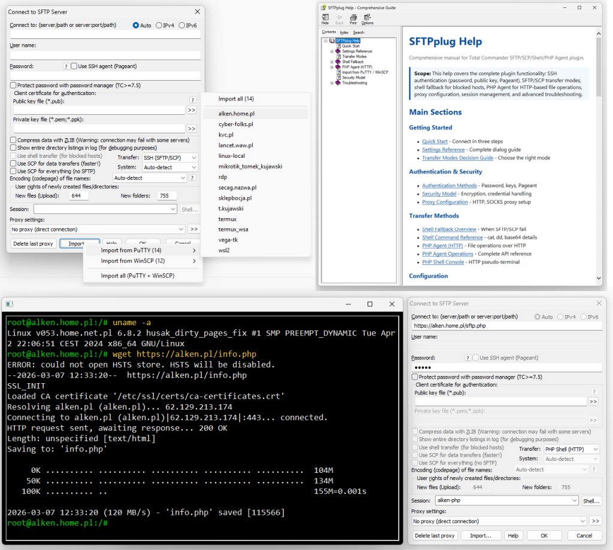

**Version 10.3.1.0** — C++20 SFTP, SCP, PHP Agent, and LAN Pair plugin for Total Commander x64 and x86, with a native arm64 build.

Complete C-to-C++20 rewrite of the original SFTP plugin by Christian Ghisler. Transport, authentication, and session subsystems use an interface-driven backend abstraction over statically linked **OpenSSL 4.1.0** and **libssh2 1.11.1**, compiled under `/W4 /WX`, Control Flow Guard, and CET. At runtime, the plugin selects native SFTP, native SCP, shell chunk transfer via `cat`/`dd`/`base64`, PHP Agent over HTTP, or direct LAN Pair based on server capabilities.

---

## Table of Contents

- [Feature Overview](#feature-overview)
- [Architecture](#architecture)
- [Transfer Protocols](#transfer-protocols)
- [Authentication System](#authentication-system)
- [Security and Password Storage](#security-and-password-storage)
- [Connection Management](#connection-management)
- [LAN Pair Transport](#lan-pair-transport)
- [PHP Agent and PHP Shell](#php-agent-and-php-shell)
  - [Command History](#command-history)
- [Remote File Operations](#remote-file-operations)
- [Shell Engineering Details](#shell-engineering-details)
- [Verification and Test Suites](#verification-and-test-suites)
- [Build System](#build-system)
- [System Requirements](#system-requirements)
- [Packaging and Installation](#packaging-and-installation)
- [PHP Agent Deployment](#php-agent-deployment)
- [Localization](#localization)
- [Roadmap](#roadmap)

---

## Feature Overview

### Transfer Protocols

| Protocol | Description |
|----------|-------------|
| **SFTP** | Primary transport. Full subsystem support, streaming transfers, resume on interrupted downloads and uploads. |
| **SCP (native)** | Faster than SFTP on many servers. Includes >2 GB file detection via 64-bit server check. |
| **Shell Fallback** | `cat` / `dd` / `base64` chunk pipeline for servers blocking SFTP subsystem and `scp`. Operates over a hidden interactive SSH channel. |
| **Jump Host (ProxyJump)** | Bastion-routed SSH via `direct-tcpip` tunneling. No external `ssh.exe` required. |
| **PHP Agent (HTTP)** | Standalone HTTP transfer mode backed by a single `sftp.php` file. Supports hosts with no SSH account or blocked subsystem. Directory uploads and batch file downloads transferred as a single TAR stream (opt-in via `php_tar` checkbox). TAR transfers replace thousands of individual HTTP requests with one POST/GET. |
| **PHP Shell (HTTP)** | Pseudo-terminal over HTTP via `SHELL_EXEC` in `sftp.php`. Persistent command history (Up/Down arrows, 128-entry ring buffer) stored in `%APPDATA%\GHISLER\shell_history.txt`. Maintains working-directory context across requests. |
| **LAN Pair** | Direct Windows-to-Windows mode. Password-authenticated PAIR3 handshake (SPAKE2, RFC 9382) with every byte after it in AES-256-GCM, LAN2 file-transfer command protocol, UDP broadcast peer discovery. |

### Authentication Methods

| Method | Notes |
|--------|-------|
| **Password** | Standard password auth. |
| **Keyboard-Interactive** | Includes automated password-change-request handling. |
| **PEM / OpenSSH** | Traditional private key formats, passed directly to libssh2. |
| **PPK v2 / v3 (native)** | Built-in PuTTY key file parser on OpenSSL: Argon2d/i/id, AES-256-CBC, HMAC. No external tools; the decoded key never touches the disk. |
| **Pageant** | SSH Agent integration. Auto-launch from `pageant.lnk` in the plugin directory. |
| **Fallback chain** | Automatic progression: Pageant → key file → keyboard-interactive → password. |

### Security Primitives

- Windows DPAPI (`CryptProtectData`) for password storage at the Windows account level.
- TC Master Password integration via `CryptProc` API with `!` sentinel.
- `SecureZeroMemory` on all sensitive buffers after use.
- LAN Pair: pair key by PBKDF2-HMAC-SHA256 (120,000 iterations), SPAKE2 P-256 handshake (RFC 9382), AES-256-GCM with per-direction keys and frame numbers.
- DPAPI-protected LAN Pair pair keys, stored per peer pair once the peer has proved the same key.
- `DllExceptionBarrier` — C++ exception firewall at every exported entry point; prevents any exception from crossing the ABI boundary into Total Commander (which would cause an immediate host crash).
- Legacy XOR passwords: read-only backward compatibility, never written for new profiles.

### Additional Capabilities

- **Folder-organised sessions** — group saved sessions into folders that appear in the plugin root listing. Folders are implicit (a folder exists while at least one session lives under it), so there is no extra setup step. F7 inside a folder creates a session there; F6 renames or moves a session across folders; F6 on a folder bulk-renames every session in it and keeps jump-host references intact. Backwards compatible with flat session profiles.
- Session import from PuTTY and WinSCP Windows Registry.
- Session import from PuTTY Portable: select the PuTTY Portable folder — the plugin finds `putty.reg` automatically (recursive search up to 4 levels deep).
- Session import from KiTTY Portable: select the KiTTYPortable root — the plugin finds the `Sessions` folder automatically (recursive search up to 4 levels deep); individual session files, only SSH sessions imported; stored passwords are automatically decrypted and saved to the plugin profile (DPAPI-protected).
- Proxy support: HTTP CONNECT, SOCKS4, SOCKS4a, SOCKS5 (with or without credentials).
- Dual-stack IPv4/IPv6 (`getaddrinfo`, `AF_INET6`).
- Host key fingerprint verification with first-connection warning and change alert.
- Remote checksum calculation without downloading: MD5, SHA1, SHA256, SHA512.
- Automatic UTF-8 filename detection via remote `locale` command.
- Automatic CRLF/LF conversion on text-mode transfers.
- Symlink tracking including `~` home directory shortcut protection.
- Localization — **16 languages**: English built in, 15 as external `.lng` files (PL/RU/DE/FR/ES/IT/CS/HU/NL/PT-BR/RO/SK/UK/JA/ZH-CN) — dynamic dialog translation at runtime, auto-detected from TC `wincmd.ini`, language-aware control layout (`ArrangeInlineRow`)
- x64 (`SFTPplug.wfx64`) and x86 (`SFTPplug.wfx`) in one Total Commander package; a native arm64 build in `SFTPplug-arm64.zip`.
- Offline help — a single page opened in your browser from the dialog's Help button.
- Background transfer support (TC `BG_DOWNLOAD` / `BG_UPLOAD` flags).
- Batch download error prompt (**Skip / Skip all / Cancel**) localized across all 16 UI languages, with Per-Monitor V2 DPI scaling and Mica titlebar support.

---

## Architecture

### Layered Structure

Every call Total Commander makes goes through one barrier, then down to the
transport the session uses. The crypto and SSH libraries are linked in; the
rest is Windows itself.

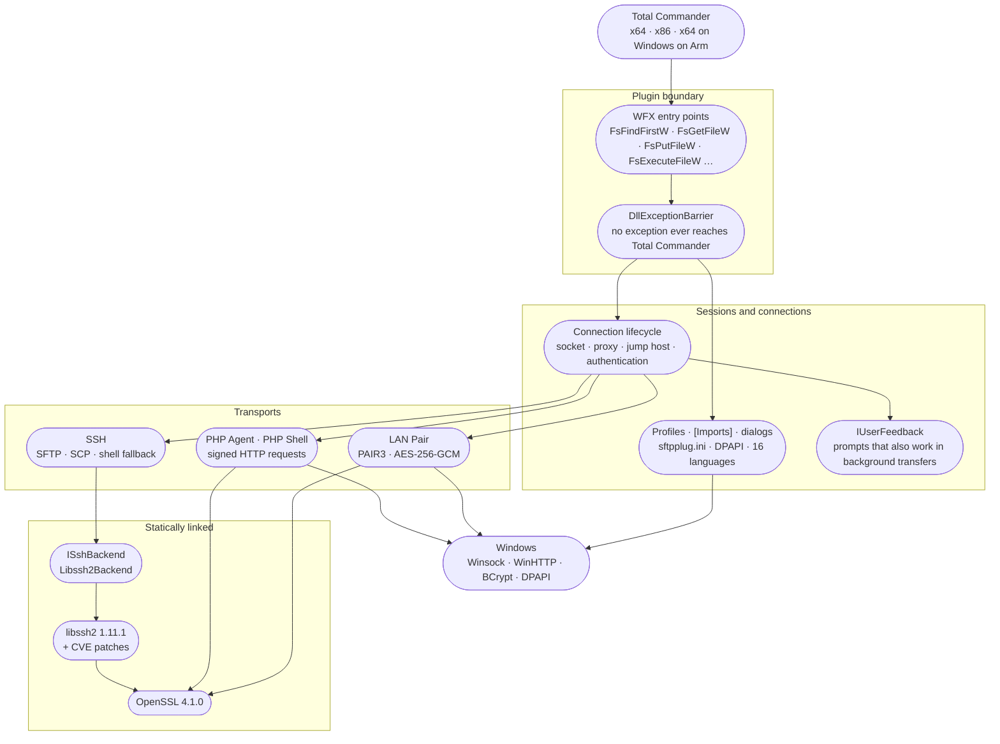

| Layer | Sources |
|-------|---------|
| Entry points and barrier | `PluginEntryPoints*.cpp`, `DllExceptionBarrier.cpp` |
| Connections | `SftpConnection.cpp`, `ConnectionNetwork.cpp`, `ProxyNegotiator.cpp`, `JumpHostConnection.cpp`, `SshSessionInit.cpp`, `ConnectionAuth.cpp`, `SessionPostAuth.cpp` |
| Transfers | `SftpTransfer.cpp`, `ScpTransfer.cpp`, `ShellFallbackTransfer.cpp`, `SftpRemoteOps.cpp` |
| PHP Agent / Shell | `PhpAgentClient.cpp`, `PhpShellConsole.cpp`, `src\agent\sftp.php` |
| LAN Pair | `LanPair.cpp` (discovery, pairing), `LanPairProtocol.cpp` (SPAKE2, encrypted channel), `LanPairSession.cpp` (file server, session) |
| SSH backend | `ISshBackend.h`, `Libssh2Backend.cpp` |
| Profiles, imports, UI | `ProfileSettings.cpp`, `PasswordCrypto.cpp`, `*Adapter.cpp`, `ConnectionDialog.cpp`, `DialogLayout.cpp`, `LngLoader.cpp` |

### Connection Lifecycle

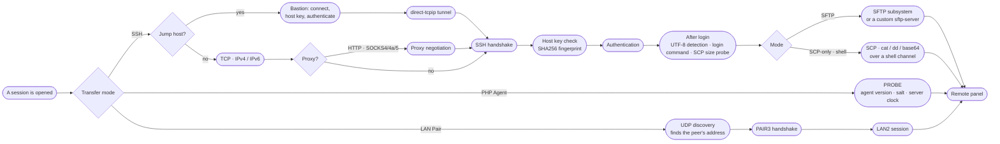
---

## Transfer Protocols

### SFTP (Primary)

Full SFTP subsystem support via libssh2. Streaming reads and writes with configurable chunk sizes. Transfer resume implemented correctly: uses `LIBSSH2_SFTP_ATTR_SIZE` flag in `fstat` to determine the actual remote file size before seeking — fixing a regression where resumes always restarted from offset 0.

### SCP (Native)

Handles the SCP wire protocol without the SFTP subsystem. Faster than SFTP on many servers due to lower protocol overhead.

**>2 GB file support:**

| Step | Implementation |
|------|---------------|
| Server architecture check | Remote `file $(which scp)` to detect 64-bit binary |
| Transfer mode | Automatic adjustment for large files |
| Fallback | Shell transfer if SCP limit is detected at runtime |

Requires libssh2 ≥ 1.7.0 for 64-bit size field support.

### Shell Fallback (DD / Base64)

For servers where the SFTP subsystem is blocked and `scp` is unavailable. Uses a hidden interactive SSH shell channel.

When SCP gives up, the plugin first tries raw bytes over an exec channel
(`cat`, `tail -c +N` to resume, `cat >` / `cat >>`) and checks the size; a
mismatch, or a profile set to shell transfer, moves the file through base64
on a persistent shell channel instead. Each command's output is framed by
`__WFX_DD_BEGIN__` / `__WFX_DD_END__` markers, so prompts, banners and echo
around it are never mistaken for data.

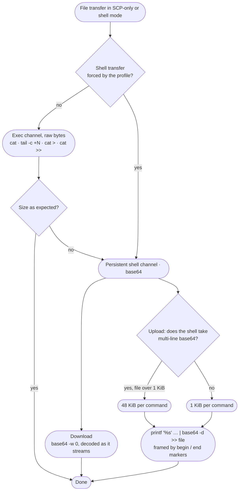

Whether the shell takes multi-line base64 is asked once per connection
(`printf '%s' 'QUJD\nREVG' | base64 -d | wc -c` must print 6). The base64
encoder and decoder are built in.

### Jump Host (ProxyJump)

Connects and authenticates to the bastion host, then opens a `direct-tcpip` channel to the final target. The full auth sequence (including PPK, Pageant, keyboard-interactive) runs on the jump host before the tunnel is established. No external `ssh.exe` binary involved.

**Pick existing session as jump host.** Next to the "Jump..." button on the F7 connection dialog there is a session-picker dropdown. Selecting an already-saved session uses its connection parameters (host, port, user, password, keys, agent) as the jump host — no need to retype them. The reference is stored as `jumpsessionref=<name>` in `sftpplug.ini` and resolved at connect time, so editing the referenced session propagates to every session that points at it (OpenSSH `ProxyJump` style). The "Jump..." button is disabled while a reference is active; pick `(none)` to switch back to manual configuration. Self-reference (picking the session being edited) is blocked at the UI level; chained or cyclic jump configurations are refused at connect time with a clear error.

### Remote Checksums

File integrity verification directly on the server:

| Algorithm | Shell commands tried |
|-----------|---------------------|
| MD5 | `md5sum` / `md5 -q` |
| SHA1 | `sha1sum` / `sha1 -q` |
| SHA256 | `sha256sum` / `shasum -a 256` |
| SHA512 | `sha512sum` / `shasum -a 512` |

---

## Authentication System

### Method Selection and Fallback

Fail-fast local validation before any network auth attempt:

| Condition | Behavior |
|-----------|----------|
| `privkeyfile` not set | Immediate local error — no fallback stall |
| Explicit `pubkeyfile` missing from disk | Immediate local error |
| Invalid PPK format | Precise error with MAC/KDF diagnostics |

This eliminates the minute-long UI freeze caused by impossible auth attempts in the original plugin.

Then the methods are tried in the order the server allows and the profile
provides. Pageant and a key file are alternatives - the profile picks one;
keyboard-interactive answers password prompts with the stored password, and
a one-time code is never kept as one.

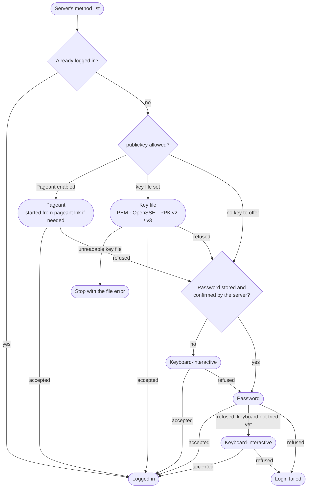

### Native PPK v2 / v3 Decoder

Converts PuTTY Private Key files to traditional PEM format for libssh2 — no external tools, no `puttygen.exe`.

**PPK v3 specification coverage:**

| Component | Implementation |
|-----------|---------------|
| KDF | Argon2d / Argon2i / Argon2id — OpenSSL `EVP_KDF`, memory, passes and lanes bounded |
| Encryption | AES-256-CBC |
| MAC | HMAC-SHA-256 over `(algorithm ‖ encryption ‖ comment ‖ public_blob ‖ private_blob_plain)` |
| MAC key source | Argon2 output bytes 48–79 (encrypted keys); empty string (unencrypted keys) |
| Crypto | OpenSSL 4.1 (`EVP_KDF`, `EVP_Q_mac`, `EVP_Decrypt*`); the key is rebuilt with `EVP_PKEY_fromdata` and checked with `EVP_PKEY_pairwise_check` |
| Output | Traditional PEM, passed to `libssh2_userauth_publickey_frommemory` |

**PPK v2** uses SHA-1-based key derivation, also fully handled natively.

SSH wire format helpers (`AppendU32`, `AppendSshStr`, `ReadSshStr`) are implemented inline without any external parser library.

### Pageant Integration

Connects via named pipe to the running Pageant agent. If Pageant is not running and `pageant.lnk` exists in the plugin directory, the plugin launches it automatically before retrying agent auth.

---

## Security and Password Storage

### Storage Modes

| Mode | INI format | Description |
|------|-----------|-------------|
| TC Master Password | `password=!` | Delegated to TC `CryptProc` API |
| DPAPI | `password=dpapi:<base64>` | `CryptProtectData`, user-account scope |
| Explicit plaintext | `password=plain:<text>` | Opt-in only |
| Legacy XOR | `<decimal triplets>` | Read-only; written in 2000s versions |

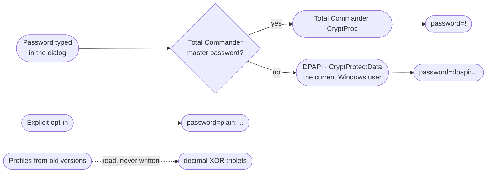

### DPAPI Implementation

After decryption, the plaintext buffer is `SecureZeroMemory`-zeroed before `LocalFree`. Base64 encoding/decoding uses Windows `CryptBinaryToStringA` / `CryptStringToBinaryA`.

### A failure in the plugin does not take Total Commander with it

Every call Total Commander makes into the plugin is wrapped, so a fault
inside it cannot reach TC's own code. You get a message describing what
went wrong, and Total Commander keeps running.

### Legacy XOR

The XOR key is hardcoded because:
1. XOR is obfuscation, not encryption — moving it would not improve security.
2. It is never used for writing new passwords.
3. Backward compatibility requires the same key to remain stable indefinitely.

Documented explicitly in source to prevent well-meaning refactors that would break existing user profiles.

---

## Connection Management

### Proxy Support

| Type | Auth |
|------|------|
| HTTP CONNECT | Basic (username:password) |
| SOCKS4 | None |
| SOCKS4a | None |
| SOCKS5 | None / username-password |


### Session Import

Sessions from other programs appear in an `[Imports]` folder in the plugin root, one subfolder per source. One adapter per source implements `IExternalSessionSource`; the enumerated lists are cached next to `sftpplug.ini` so they are available immediately at startup.

| Source | Auto-detected location | Custom location accepts |
|--------|------------------------|-------------------------|
| SecureCRT | `%APPDATA%\VanDyke\Config\Sessions\` | Any SecureCRT session tree |
| PuTTY | `HKCU\Software\SimonTatham\PuTTY\Sessions` | A `putty.reg` export |
| WinSCP | `HKCU\Software\Martin Prikryl\WinSCP 2\Sessions` | A portable `WinSCP.ini` |
| FileZilla | `%APPDATA%\FileZilla\sitemanager.xml` | Any `sitemanager.xml` |
| KiTTY | `%APPDATA%`, `%LOCALAPPDATA%`, `%USERPROFILE%` under `KiTTY\Sessions\`, or the path behind the `.kitty` file association | The `Sessions\` folder or the install root |
| OpenSSH | `%USERPROFILE%\.ssh\config`, with its `Include` files | Any `ssh_config`-style file |

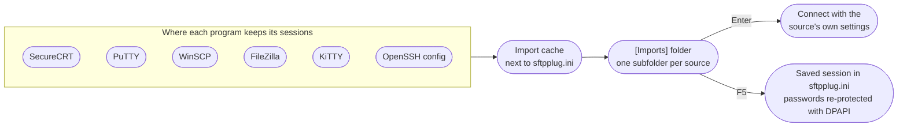

**Behaviour:**
- `Enter` connects using the settings read from the source; nothing is written to the plugin's own configuration
- `F5` materialises the session into `sftpplug.ini` as a regular saved entry — `Ctrl+A` first to take a whole source at once
- `[Refresh]` re-reads one source; `[Add custom location...]` and `[Manage custom locations]` handle portable installs
- Only sessions the plugin can serve are listed — non-SSH protocols, WinSCP workspaces and `Default Settings` templates are filtered out
- Folder hierarchies from the source are preserved as nested panel folders
- Passwords: imported for KiTTY and for FileZilla sites using base64 storage; PuTTY keeps none on disk; WinSCP and SecureCRT are left for the interactive prompt. Imported values are re-protected with DPAPI
- Key files carry over with environment variables resolved; `.ppk` v2/v3/ed25519 are converted natively
- Proxy, firewall and tunnel definitions are **not** carried over yet

### Host Key Verification

The fingerprint is stored per server in the INI as SHA256, in the form OpenSSH prints it (`SHA256:…`), so it can be checked on the server with `ssh-keygen -lf`; the prompt shows the MD5 as well. An MD5 stored by an older version still matches and is rewritten as SHA256 on that connection. The first connection asks for acceptance, a changed key raises an explicit warning, and a jump host keeps its own fingerprint. Both prompts go through `IUserFeedback`, so they work in background transfers too.

---

## LAN Pair Transport

Direct Windows-to-Windows file transfer without SSH. Uses a custom application-layer protocol stack over TCP/UDP on the local network.

### Discovery (UDP Broadcast)

A background thread broadcasts peer announcements and collects incoming ones.

| Parameter | Default |
|-----------|---------|
| UDP broadcast port | 45845 |
| TCP pairing port | 45846 |
| Broadcast interval | 2000 ms |
| App tag | `KVCPAIR/1` |

`PeerAnnouncement` fields: `peerId`, `hostName`, `displayName`, `ip`, `tcpPort`, `role` (`Donor` / `Receiver` / `Dual`), `lastSeen`.

### PAIR3 Handshake and Encrypted Channel

Both computers are given the same pairing password. Each turns it into the
pair key, `PBKDF2-HMAC-SHA256(password, salt, 120 000 iterations, 32 bytes)`
with the salt derived from the two peer ids, and neither ever sends it:

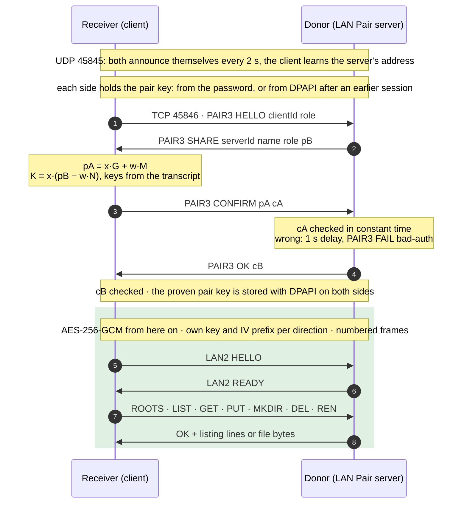

On the wire, before the encryption starts:

```
Client → Server:  PAIR3 HELLO   <clientId> <role>
Server → Client:  PAIR3 SHARE   <serverId> <displayName> <role> <pB>
Client → Server:  PAIR3 CONFIRM <pA> <cA>
Server → Client:  PAIR3 OK      <cB>            or  PAIR3 FAIL <reason>
```

`pA`, `pB`, `cA` and `cB` are SPAKE2 (RFC 9382, suite
SPAKE2-P256-SHA256-HKDF-HMAC; the client is A, the server B), with the pair
key, through HKDF and reduced modulo the group order, as the password scalar.
Someone who records the exchange learns nothing to test passwords against
offline; someone who joins it gets one guess per connection, and a wrong
proof costs a second. The implementation is checked against the RFC's test
vector.

From then on every byte goes in AES-256-GCM frames: a 4-byte length (in the
additional data), the ciphertext, a 16-byte tag. Each direction has its own key
and IV prefix from `HKDF(Ke, salt = Hash(TT))`, and the IV carries a frame
counter, so a frame that is altered, replayed, dropped or reordered ends the
connection. A plugin older than 10.3.1 gets `PAIR1 FAIL upgrade-required` - both
computers need 10.3.

Pairing requires the password. After a successful handshake each side stores
the pair key, and later sessions may leave the password empty.

### LAN Pair Roles

| Role | INI value | Behavior |
|------|-----------|----------|
| **Donor** | `lanpairrole=2` | Starts the local LAN Pair file server; waits for incoming Receiver connections; refuses to initiate outgoing connections. Use on the machine whose files will be accessed remotely. |
| **Receiver** | `lanpairrole=1` | Does not start a local file server; connects as client to the Donor. Use on the machine that will browse and transfer files. |
| **Auto** | `lanpairrole=0` | Starts the local file server and shows a guided 60-second pairing wizard. |

In the **Auto** wizard: **Yes** = connect immediately to the discovered peer (this machine acts as Receiver/client); **No** = stay as server/Donor; **Cancel** = stop server.

### TrustedInstaller Access

When the **Trusted Installer** checkbox (`lanparti=1`) is enabled:

- **As Donor (server):** incoming connections are served under TrustedInstaller impersonation — the remote Receiver can read, write, delete, and rename files owned by TrustedInstaller on this machine (e.g. files in `C:\Windows\`, Windows Update caches, `WindowsApps`).
- **As Receiver (client):** file transfers on this machine run under TI impersonation — allows downloading to TI-protected local directories and uploading from TI-protected local paths.

Impersonation is per-connection (server) or per-transfer (client) and is always reverted after use. Requires `SeDebugPrivilege` (elevated TC). The TrustedInstaller service is started automatically if not already running.

### DPAPI Pair Key Storage

Pair keys are held as DPAPI blobs in `%APPDATA%\GHISLER\sftpplug.secrets`, named `lanpair_trust_srv_<serverPeerId>__<clientPeerId>` and `lanpair_trust_cli_...`, one per peer pair and direction. They are saved with `CRYPTPROTECT_LOCAL_MACHINE`, so a TrustedInstaller context can read them too. A key is stored only after the peer has proved it holds the same one; a blob that no longer decrypts is deleted, and the next connection made with the password stores the key again.

### LAN2 Command Protocol

After the handshake the same connection, encrypted, carries LAN2: one command
line, one reply line, then any listing lines or raw file bytes. Paths are UTF-8
in base64.

| Command | Reply |
|---------|-------|
| `LAN2 HELLO` | `LAN2 READY` |
| `ROOTS` | `OK <n>`, then one drive per line |
| `LIST <path>` | `OK <n>`, then `<F\|D> <size> <mtime> <attrs> <name>` per entry |
| `GET <path> <offset>` | `OK <bytes>`, then the file from `offset` |
| `PUT <path> <size>` | `OK`; the client sends the bytes; `DONE` |
| `MKDIR`, `DEL <path>` | `OK` or `ERR <reason>` |
| `REN <old> <new> <0\|1>` | `OK`, `ERR exists` (when 0) or `ERR rename-failed` |
| `QUIT` | `BYE` |

Session timeout configurable via `setTimeoutMin(int minutes)`. When a non-zero timeout is set, every `cmd()` call checks elapsed time via `std::chrono::steady_clock` and closes the session automatically when the limit is reached. All methods are `noexcept`.

---

## PHP Agent and PHP Shell

### PHP Agent (HTTP)

Single-file `sftp.php` deployed on the web server. The plugin communicates via WinHTTP (`winhttp.lib`), sending chunked `multipart/form-data` for uploads and receiving raw bytes for downloads.

Operations supported: `PROBE`, `LIST`, `GET`, `PUT`, `MKDIR`, `REMOVE`, `RENAME`, `CHMOD`, `STAT`, `TAR_STREAM`, `TAR_EXTRACT`, `TAR_PACK`, `SHELL_EXEC`.

#### Signed requests (TCSFTP-HMAC-V2)

The password never leaves the computer. `PROBE`, the only unsigned request,
gives the salt and the server's clock; every other request carries an
HMAC-SHA256 signature over its method, operation, every parameter, the hash
of its body, the time and a single-use nonce. A body is staged and checked
against its signed hash before the agent uses any of it.

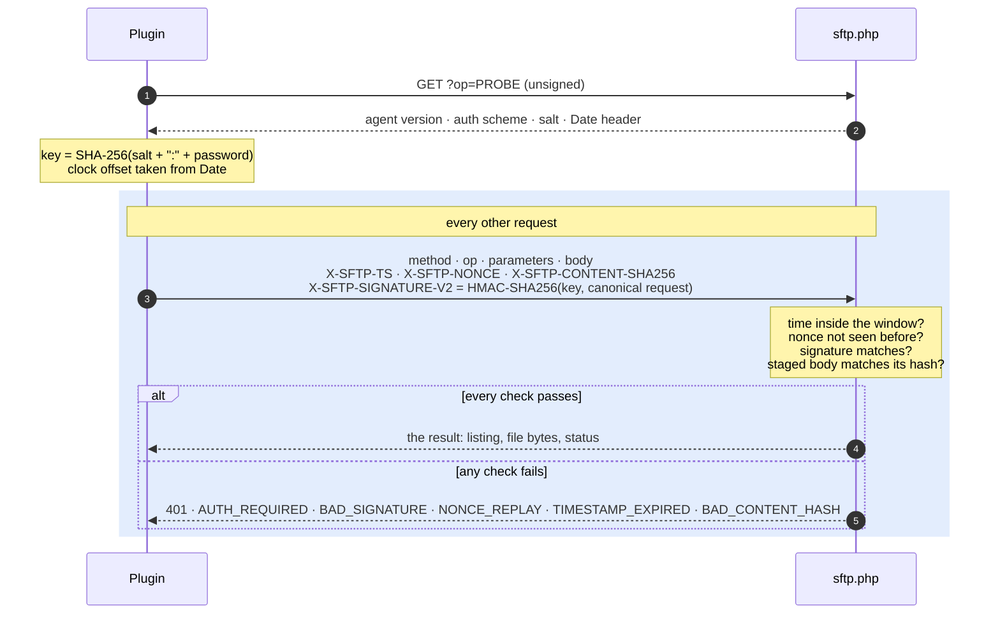

The agent keeps only the salted hash (`AGENT_PSK_SALT`, `AGENT_PSK_SHA256`)
or reads the password from the `TC_SFTP_AGENT_PSK` environment variable;
either way it derives the same key.

#### TAR Streaming — Upload (TAR_EXTRACT) and Batch Download (TAR_PACK)

When the `php_tar` checkbox is enabled in the connection profile, all directory copies and batch file transfers use a single TAR HTTP round-trip instead of individual `PUT`/`GET` requests. This eliminates per-request overhead — critical on shared hosting (OVH, home.pl) where even small files cost full HTTP round-trip latency.

**Upload (TAR_EXTRACT)**

TC's `FsStatusInfo` `PUT_MULTI` / `PUT_MULTI_THREAD` session is used to collect all files. The plugin runs a first pass to compute the exact total size, then streams the complete POSIX ustar TAR in a single WinHTTP POST to `?op=TAR_EXTRACT`. The server stages the archive in a temporary file, checks it against the signed hash, and only then extracts it with a streaming parser (`tar_extract_stream`) — an altered archive writes nothing. `Content-Length` is sent as a 64-bit header value (no 4 GB overflow). Regular `.tar` file uploads without `php_tar` enabled are unaffected.

**Batch Download (TAR_PACK)**

When TC signals a multi-file download (`FsStatusInfo GET_MULTI` / `GET_MULTI_THREAD`), each `FsGetFileW` call is intercepted and the remote path queued into `TarDownloadSession`. When the batch ends, a single POST to `?op=TAR_PACK` is sent with all remote paths (newline-separated). The server streams the ustar TAR directly to `php://output` with no buffering — no 504 Gateway Timeout even for large archives. The plugin parses the TAR stream on the fly, writing files as each entry arrives.

Both directions support **GNU LongLink** (`././@LongLink`, typeflag `L`) for paths longer than 99 characters. Files exceeding 8 589 934 591 bytes (POSIX ustar limit) are skipped cleanly without corrupting the rest of the archive.

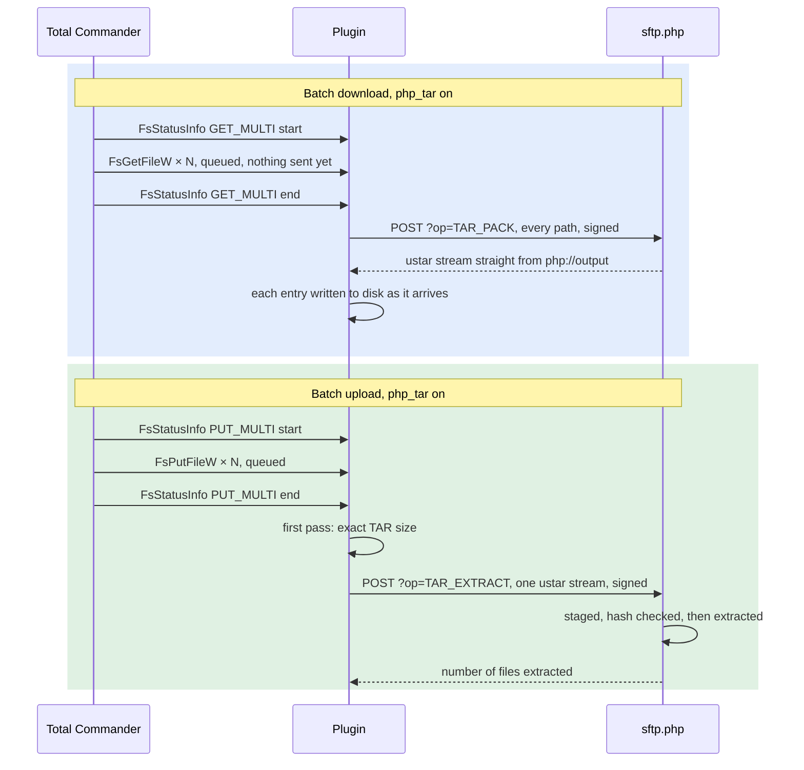

`AgentUrl` struct parsed from connection profile: `secure` (HTTPS), `host`, `port`, `object` path.

### PHP Shell (HTTP)

Uses the same `sftp.php` endpoint but routes commands through `SHELL_EXEC`. Maintains working-directory awareness across requests. Provides a pseudo-terminal experience for operational tasks on hosts with no SSH access.

#### Command History

The shell console maintains a **persistent** command history that survives session restarts and plugin reloads.

**Navigation**

| Key | Action |
|-----|--------|
| `↑` Up arrow | Recall previous command |
| `↓` Down arrow | Move forward through history (↓ after reaching the end clears the input line) |

**Storage location**

```
%APPDATA%\GHISLER\shell_history.txt
```

This is the same directory Total Commander uses for its own configuration, keeping all related data in one place. The file is a plain UTF-8 text file, one command per line, and can be opened or inspected in any text editor.

**Capacity — ring buffer**

The file holds a maximum of **128 entries**. When the 129th command is added, the oldest entry is dropped from the top. The file is always rewritten in full on every addition — at 128 short lines this is a negligible I/O cost and eliminates any possibility of stale data from a partial write.

**Duplicate suppression**

Consecutive identical commands are not added to history (equivalent to bash `HISTCONTROL=ignoredups`). Running the same command twice in a row records it only once.

**Clearing history**

History can be cleared from inside the shell console without leaving it:

```bash
history -c
```

or equivalently:

```bash
clear history
```

Both commands erase all entries from memory **and** delete `shell_history.txt` from disk immediately. The cursor resets to an empty state. This is equivalent to `history -c` in bash and is the recommended way to clear sensitive command traces (e.g. after typing a password inline).

> **Note:** `exit` and `logout` close the console window but do **not** clear history — existing entries are preserved for the next session.

**Power-loss and crash safety**

Each write uses an atomic two-step pattern:

1. The new content is written to a temporary file (`shell_history.txt.tmp`) in the same directory.
2. `MoveFileExA` with `MOVEFILE_REPLACE_EXISTING` renames the temp file over the real file.

On NTFS, a rename within the same volume is a single metadata operation. If power is lost or the process is killed between steps 1 and 2, the previous `shell_history.txt` remains intact — it is never truncated or partially overwritten. The worst-case outcome is a leftover `.tmp` file containing the most recent history, which can be renamed manually if needed.

### PHP Agent Deployment

> **Critical:** `sftp.php` and the plugin are a matched pair — after
> updating the plugin, upload the `sftp.php` that came with it, or
> transfers relying on newer operations will fail against the old script.
>
> **Also:** the `sftp.php` in the release package ships with **no password configured**. Uploading it before saving a session in the plugin will result in HTTP 503 on every connection attempt. Always follow the order below.

**Step 1 — Configure and save the session in Total Commander**

Open the plugin connection dialog (Net → Connect). Fill in:

| Field | Value |
|-------|-------|
| **Connect to** | Full URL to `sftp.php` on your server, e.g. `https://example.com/sftp.php` |
| **Transfer mode** | `PHP Agent (HTTP)` (or `PHP Shell (HTTP)`) |
| **Password** | Your chosen shared secret |
| **Session name** | Any label, e.g. `My Hosting` |

Click **Save**. The plugin writes a salted SHA-256 hash (`AGENT_PSK_SALT` + `AGENT_PSK_SHA256`) into its local copy of `sftp.php`. The password itself is never stored in the file.

**Step 2 — Upload the modified `sftp.php`**

Copy the local file (containing your hash) to the server:

```
...\Total Commander\plugins\wfx\SFTPplug\sftp.php  →  https://example.com/sftp.php
```

Use FTP, cPanel File Manager, or any other method. Do **not** upload the original from the download package — it has empty PSK fields.

**Step 3 — Verify the endpoint**

Open `https://example.com/sftp.php?op=PROBE` in a browser:

| Response | Meaning |
|----------|---------|
| HTTP 200 `{"ok":true,...}` | Ready — proceed to connect |
| HTTP 401 Unauthorized | Script running, awaiting auth — also OK |
| HTTP 503 Service Unavailable | PSK not configured — wrong file uploaded; repeat from Step 1 |
| HTTP 404 Not Found | Wrong URL or file not yet uploaded |

**Step 4 — Connect**

Select the saved session in Total Commander and connect.

**Security model**

| Location | Stored | Password exposed? |
|----------|--------|-------------------|
| `sftpplug.ini` (your PC) | Password encrypted with Windows DPAPI | No |
| `sftp.php` (server) | `AGENT_PSK_SALT` + SHA-256(salt + password) | No — one-way hash, but it is the signing key: keep the file private |
| Network | A signature per request (TCSFTP-HMAC-V2: HMAC-SHA256 over method, operation, every parameter, body hash, time and single-use nonce) | No — the password never travels |

Reading `sftp.php` on the server gives the hash, which signs requests but does not reveal the password; a long random password keeps it from being guessed offline. Requests cannot be altered or replayed even over plain HTTP, but the files themselves can be read there: HTTPS is required beyond local testing.

PHP Shell runs commands as the web server user, outside `AGENT_ROOT` too. Set `AGENT_ALLOW_SHELL = false` in `sftp.php` when the shell is not needed.

---

## Remote File Operations

All operations are available over SFTP, SCP, and PHP Agent modes (where applicable).

| Operation | SFTP | SCP/Shell | PHP Agent |
|-----------|------|-----------|-----------|
| Directory listing | Native SFTP readdir | `ls -la` + `__WFX_LIST_BEGIN__` / `__WFX_LIST_END__` markers | Agent `LIST` command |
| Download | Native, with resume | Shell / `cat` | Agent `GET` |
| Upload | Native, with resume | Shell / `dd` / base64 | Agent `PUT` |
| Rename / Move | SFTP `rename` | Remote `mv` | Agent `RENAME` |
| Delete file/tree | SFTP `unlink` / recursive | Remote `rm -rf` | Agent `REMOVE` |
| Create directory | SFTP `mkdir` | Remote `mkdir` | Agent `MKDIR` |
| Chmod | SFTP `setstat` | Remote `chmod` | Agent `CHMOD` |
| Set attributes (`FsSetAttrW`) | SFTP lstat → RMW write bits → setstat | — | — |
| Timestamps | SFTP `setstat` | Remote `touch` | — |
| Symlink resolution | SFTP `realpath` | Parsed from `ls -la` output | — |
| Remote checksum | Shell command | Shell command | — |
| File properties | SFTP `stat` | Shell `stat` | Agent `STAT` |

### Symlink and Tilde Handling

Symlinks are parsed from `ls -la` long-entry format and followed recursively. Special protection against downloading the literal string `~` as a file: the plugin detects this case, reconnects, and retries with the resolved home path.

---

## Shell Engineering Details

### Marker-Aware Directory Listing & ECMA-48 Filtering

Real SSH servers vary in shell behavior (prompts, echo, MOTD, systemd `OSC 3008`, bracketed paste `ESC[?2004h`). The plugin injects unique markers to delimit directory output reliably and filters ANSI/ECMA-48 control sequences (`TerminalText.cpp`):

| Marker | Purpose |
|--------|---------|
| `__WFX_LIST_BEGIN__` | Start of `ls -la` output |
| `__WFX_LIST_END__` | End of `ls -la` output |
| `echo $?` | Exit code detection after command |

### Restricted Server Handling

| Scenario | Mitigation |
|----------|-----------|
| SFTP subsystem blocked or non-standard path | Custom `sftp-server` init command, or fall through to SCP / shell fallback |
| `scp` not available | Multi-line `base64` / `cat` / `dd` chunk transfer (up to 49,152 B per command) |
| Noisy shell prompts / OSC sequences | ECMA-48 terminal filter with marker anchoring |
| Delayed output (slow server) | Staggered read timeouts per stage |
| No 64-bit `scp` (>2 GB) | Automatic detection, fallback to shell transfer |

### UTF-8 Detection

Remote `locale` command output is parsed to determine the server's character encoding (`UnicodeHelpers.cpp` / `TextConversion.cpp`), preserving non-codepage Unicode paths end-to-end.

---

## Verification and Test Suites

Every suite compiles the plugin's own sources under the same `/W4 /WX` as the plugin and runs against the Release builds of each architecture: x64 and x86 everywhere, arm64 on Windows on Arm (which also runs x64 and x86 under emulation). On an x64 machine the arm64 tests are compiled and left for an Arm machine. Every test creates its own files and removes only those. The latest full run is in [`tests/RESULTS.md`](tests/RESULTS.md).

```powershell
.\tests\run-all-tests.ps1 -Profiles <sftpplug.ini section> -LanPairHost <another Windows PC>
```

builds the plugin and runs everything below, each step even after a failed one, and ends with a summary; `-SkipBuild` tests the binaries already built, `-SkipPhp` leaves out the PHP Agent. Each runner also works on its own; `-Arch x64|x86|arm64|both|all` picks the architectures.

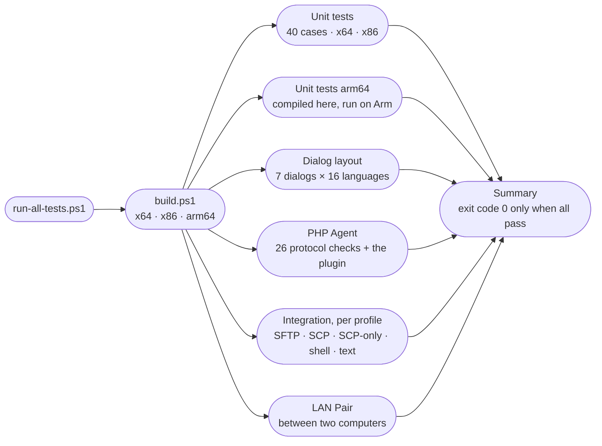

| Suite | Runner | Scope and Methodology |
|-------|--------|-----------------------|
| **Unit tests** | `tests\run-unit-tests.ps1` | 40 test cases and 325,538 assertions per architecture. Validates PPK v2/v3 parsing and OpenSSL 4.1.0 Argon2id decryption against deterministic RSA, ECDSA P-256/P-384/P-521, and Ed25519 fixtures in `tests\fixtures\ppk`, UTF-8 and CRLF conversion, ECMA-48 control-sequence stripping, LAN Pair cryptography (PBKDF2, SPAKE2 against the RFC 9382 vector, AES-GCM frames that are altered, replayed or reordered), a LAN Pair file server and session end to end on the loopback interface, DPAPI/legacy password codecs, and wildcard matching. |
| **UI layout tests** | `tests\run-ui-tests.ps1` | Instantiates all 7 Win32 dialog templates, including `download-error`, across all 16 localizations under Per-Monitor V2 DPI scaling. Computes rendered glyph extents against control bounding boxes to fail on clipped text, overlapping controls, or out-of-bounds geometry. |
| **Integration tests** | `tests\run-integration-tests.ps1 -Profile <section>` | Loads the compiled `.wfx` plugin via `PluginHarness.cpp` against a live OpenSSH server across 5 transfer paths: SFTP, SCP data, SCP-only, shell fallback, and CRLF/LF text conversion — and the *Skip / Skip all* batch prompt, answered through its own dialog the way a user would. The server comes from an `sftpplug.ini` section or from `-Server`/`-User`/`-KeyFile`. |
| **PHP Agent** | `tests\run-php-agent-tests.ps1` | Starts `php -S` on a free local port with the shipped `sftp.php`, in both password configurations (PSK in the environment, salted hash in the script). 26 protocol checks - signatures, replayed nonces, stale timestamps, altered bodies, legacy authentication refused - then the integration suite through the plugin in PHP mode. Runs whenever `php.exe` is found. |
| **LAN Pair, two computers** | `tests\run-lanpair-remote-test.ps1 -RemoteHost <pc>` | Runs the plugin's LAN Pair sources as a file server on another Windows computer (over ssh) and as the client here: pairing with a fresh random password, a 16 MiB round trip with a UTF-8 file name, rename and delete, a session on the stored keys, a refused wrong password. Opens one firewall rule there, for this computer only, and removes it, the program, its files and the test keys on both computers afterwards. |
| **PHP Agent harness** | `tools\php-agent-test\docker-compose.yml` | Reproduces HTTP TAR upload, TAR streaming download, and `SHELL_EXEC` workflows against a local PHP container. |

---

## Build System

Two scripts at the project root. Both find Visual Studio, the MSVC toolset and the Windows SDK on their own (`tools\Toolchain.psm1`), choosing the ones whose compiler, assembler and libraries actually exist on disk; no version number is written into them.

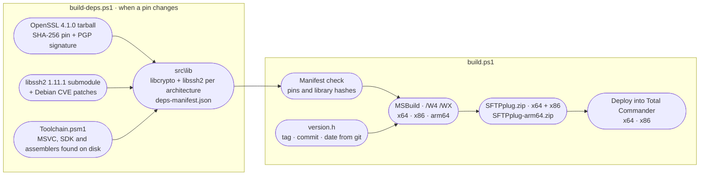

**1. Dependencies** — once, and again whenever a pin changes:

```powershell
.\build-deps.ps1                # OpenSSL 4.1.0 + libssh2 1.11.1: x64, x86 and arm64
.\build-deps.ps1 -amd64 -arm64  # the ones named (-amd64 is also -x64)
.\build-deps.ps1 -Clean         # rebuild from scratch
```

- OpenSSL comes as the release tarball, checked against a pinned SHA-256 and the OpenSSL release key in `thirdparty\keys\`. It is built with `no-autoload-config`, so no `openssl.cnf` on a user's machine is ever read.
- libssh2 is the `thirdparty\libssh2` submodule plus Debian's CVE patches (`thirdparty\patches\libssh2-1.11.1\series`).
- Both are linked statically with `/MT`. `src\lib\deps-manifest.json` records the pins and the SHA-256 of every library built; `build.ps1` refuses libraries that do not match it.
- Needs a native Perl (Strawberry), NASM (x64, x86) and CMake. Paths that are not found automatically go into `build.local.psd1` (see `build.local.example.psd1`).
- arm64 is cross-compiled on an x64 machine and built natively on Windows on Arm. OpenSSL's ARMv8 assembly (AES, SHA, GHASH and ChaCha20 on the CPU's crypto extensions) needs `clang-cl` - Visual Studio's *C++ Clang tools for Windows* component or LLVM; without it, OpenSSL for arm64 is built from C alone, and the build says so.

**2. The plugin:**

```powershell
.\build.ps1                 # x64 + x86 + arm64, help page, packages, deploy into Total Commander
.\build.ps1 -amd64 -arm64   # the architectures named (-amd64 is also -x64; -x86, -arm64)
.\build.ps1 -NoDeploy       # leave Total Commander alone
.\build.ps1 -NoHelp -NoZip  # plugin binaries only
```

- Release build: C++20, `/W4 /WX` with no warning switched off, `/permissive-`, `/GS`, Control Flow Guard, CET shadow stack (x64), static CRT.
- Reproducible: two builds of one commit with the same toolchain give byte-identical `.wfx` files. `/Brepro` drops the timestamps, and the tag, short SHA and commit date shown by the plugin come from git, never from the clock (`-dirty` marks uncommitted changes).
- Before a release: `.\tests\run-all-tests.ps1 -Profiles <sftpplug.ini section> -LanPairHost <another Windows PC>` builds and runs every test suite, and ends with a summary.
- The plugins land in `build\bin\x64_Release`, `build\bin\Win32_Release` and `build\bin\ARM64_Release`; the packages and the help page in `bin\`. The help page needs Python 3.
- The tests build for arm64 too. Where they cannot run (arm64 on an x64 machine) they are compiled - under the same `/W4 /WX` - and left for Windows on Arm, which runs all three architectures.
- Deploying asks Total Commander to close (it is never killed), copies the plugin into `plugins\wfx\SFTPplug` and starts Total Commander again.

**Diagnostic log:** off in every build. `DebugLog=1` under `[Configuration]` in `sftpplug.ini`, or `SFTPPLUG_DEBUGLOG=1` in the environment, writes `%LOCALAPPDATA%\SFTPplug\sftpplug.log`.

---
## System Requirements

| Component | Requirement |
|-----------|-------------|
| Windows | Windows 7 or later (Windows 10/11 recommended) |
| Total Commander | Version 9.0 or later (x64 or x86) |
| Architecture | x64 (`SFTPplug.wfx64`), x86 (`SFTPplug.wfx`); native arm64 in `SFTPplug-arm64.zip` |
| Compiler (build) | Visual Studio 2026, MSVC v145 toolset, C++20 |
| libssh2 | Statically linked (1.11.1), built against OpenSSL |
| OpenSSL | Statically linked (4.1.0) — the crypto backend of libssh2 and of the PPK decoder |
| **Dependencies** | None — OpenSSL and libssh2 are statically linked with `/MT`, so no VC++ Redistributable is required |
| Windows APIs | BCrypt, DPAPI (CryptProtectData), WinHTTP, DbgHelp, Winsock2 |

---

## Packaging and Installation

Distribution archive: `SFTPplug.zip` (Total Commander: x64 and x86). Total Commander has no arm64 build - on Windows on Arm it runs as x64 under emulation and uses `SFTPplug.wfx64` from this package. `SFTPplug-arm64.zip` holds the native arm64 plugin for hosts that run natively on Arm; it carries no `pluginst.inf`, so Total Commander never installs it where it cannot be loaded.

| File | Purpose |
|------|---------|
| `SFTPplug.wfx64` | x64 plugin binary (OpenSSL and libssh2 statically linked, `/MT`) |
| `SFTPplug.wfx` | x86 plugin binary (OpenSSL and libssh2 statically linked, `/MT`) |
| `pluginst.inf` | Total Commander auto-install descriptor (`file=` x86, `file64=` x64) |
| `sftp.php` | PHP Agent script for HTTP transfer and shell modes |
| `SFTPplug-help.html` | Full offline documentation, one self-contained page |
| `readme.txt` | Package notes |
| `language\pol.lng` | Polish |
| `language\rus.lng` | Russian |
| `language\deu.lng` | German |
| `language\fra.lng` | French |
| `language\esp.lng` | Spanish |
| `language\ita.lng` | Italian |
| `language\cs.lng` | Czech |
| `language\hu.lng` | Hungarian |
| `language\nl.lng` | Dutch |
| `language\pt-br.lng` | Brazilian Portuguese |
| `language\ro.lng` | Romanian |
| `language\sk.lng` | Slovak |
| `language\uk.lng` | Ukrainian |
| `language\ja.lng` | Japanese |
| `language\zh-cn.lng` | Simplified Chinese |

No external DLLs required. OpenSSL and libssh2 are built from verified sources with `/MT` (static CRT) and linked into the binary — no VC++ Redistributable needed on the target system.

Open `SFTPplug.zip` in Total Commander and press Enter to trigger the plugin install prompt.

---

## Localization

On startup the plugin reads `HKCU\Software\Ghisler\Total Commander\IniFileName` to locate `wincmd.ini`, then reads `LanguageIni` from the `[Configuration]` section (e.g. `WCMD_POL.LNG` → Polish, `WCMD_CZ.LNG` → Czech, `WCMD_JP.LNG` → Japanese). The matched language ID selects the correct `.lng` file. Language loading is triggered from both `FsSetDefaultParams` and `FsInit` to cover all TC load orders.

The binary ships with an English-only compiled resource (`sftpplug.rc`). All non-English translations are provided as external UTF-8 files in the `language\` subdirectory and loaded at runtime via `LngLoader`. Dialog labels, checkboxes, buttons and window captions are all translated dynamically in `WM_INITDIALOG` using `SetDlgItemTextW`. Layout of variable-length rows (e.g. the Jump host line) is adjusted dynamically based on measured text width so all languages fit without overlap or excessive gaps.

| File | Language |
|------|----------|
| *(binary)* | English (US) — built-in fallback |
| `language\pol.lng` | Polish |
| `language\rus.lng` | Russian |
| `language\deu.lng` | German |
| `language\fra.lng` | French |
| `language\esp.lng` | Spanish |
| `language\ita.lng` | Italian |
| `language\cs.lng` | Czech |
| `language\hu.lng` | Hungarian |
| `language\nl.lng` | Dutch |
| `language\pt-br.lng` | Brazilian Portuguese |
| `language\ro.lng` | Romanian |
| `language\sk.lng` | Slovak |
| `language\uk.lng` | Ukrainian |
| `language\ja.lng` | Japanese |
| `language\zh-cn.lng` | Simplified Chinese |

### Language override

If TC uses a language the plugin cannot auto-detect (custom/community language file, or a language not in the supported 15), the UI falls back to English. This can be overridden via `[Configuration]` in `sftpplug.ini`:

```ini
[Configuration]
Language=English
```

Accepted values: `English`, `Polish`/`pol`/`pl`, `German`/`deu`/`de`, `French`/`fra`/`fr`, `Spanish`/`esp`/`es`, `Italian`/`ita`/`it`, `Russian`/`rus`/`ru`, `Czech`/`cs`, `Hungarian`/`hu`, `Japanese`/`ja`, `Dutch`/`nl`, `Portuguese`/`pt-br`, `Romanian`/`ro`, `Slovak`/`sk`, `Ukrainian`/`uk`, `Chinese`/`zh-cn`.

Custom `.lng` files are also supported: place `language\fin.lng` in the plugin directory and set `Language=fin`. Any string not found in the file falls back to English automatically.

The file `sftpplug.tpl` (shipped with the plugin) is copied to `sftpplug.ini` on first run as a template with documentation comments.

To add a new language: create `language\XYZ.lng` (UTF-8) following the existing format (`ID=text`, `#` comments, RC-style `\n \t \\` escapes) and deploy it alongside the plugin. If you want full LANGID mapping (Windows locale for date/number formatting), also add the code to `LangIdToTcCode` in `LngLoader.cpp`.

---

## Roadmap

### Completed

- ISshBackend abstraction layer
- Native PPK v2/v3 conversion (OpenSSL, no tools)
- Shell DD/base64 fallback transfer
- LAN Pair transport (PAIR3 SPAKE2 handshake, AES-256-GCM channel, LAN2 protocol, UDP discovery, DPAPI-stored pair keys)
- LAN Pair session timeout (configurable, enforced at session level)
- Session import from PuTTY and WinSCP registry
- Remote checksum (MD5/SHA1/SHA256/SHA512)
- SCP >2 GB detection
- DPAPI + TC Master Password integration
- SFTP resume fix (`LIBSSH2_SFTP_ATTR_SIZE`)
- `FsSetAttrW` implementation (lstat → RMW → setstat)
- Setstat null guard (SCP mode)
- Tilde symlink protection
- December month parse fix (`FtpDirectoryParser`)
- Debug logging disabled in Release
- `DllExceptionBarrier` — ABI exception firewall with DbgHelp stack trace
- `ConnectionGuard` RAII — leak-free connection lifecycle in `FsFindFirstW`
- `UpdateCertSectionState` — unified cert section control for all transport modes
- x64 and x86 packaging — single ZIP with both architectures, TC auto-install via `pluginst.inf`
- **arm64 build** — plugin, OpenSSL and libssh2 cross-compiled or built natively on Windows on Arm; separate `SFTPplug-arm64.zip`
- **Signed PHP Agent requests** — TCSFTP-HMAC-V2, the password never leaves the computer, bodies verified before use
- PHP Shell persistent command history — ring buffer (128 entries), atomic NTFS write, `%APPDATA%\GHISLER\shell_history.txt`, `history -c` / `clear history` commands
- **`[Imports]` magic folder** — sessions from SecureCRT, PuTTY, WinSCP, FileZilla and KiTTY listed as live entries, one subfolder per source; `Enter` connects, `F5` materialises into `sftpplug.ini`; per-source `[Refresh]` and custom portable locations; enumeration cached next to the INI so entries are present at startup
- **KiTTY password import** — obfuscated session passwords decoded natively, with no external helper binary, and re-stored as DPAPI
- **FileZilla password import** — base64-stored site passwords carried over; master-password sites left to the interactive prompt
- **15-language localization** — added CS/HU/NL/PT-BR/RO/SK/UK/JA/ZH-CN; all auto-detected from TC `wincmd.ini` `LanguageIni` setting
- **Language override** — `Language=` key in `[Configuration]` of `sftpplug.ini`; supports all 15 built-in languages by name/ISO code, plus custom `.lng` stems for unsupported languages; `sftpplug.tpl` template shipped with the plugin
- **LAN Pair strict roles** — Donor/Receiver/Auto with unidirectional enforcement; Donor starts file server and refuses outgoing connections; Receiver connects as client without starting a local server
- **LAN Pair TrustedInstaller** — per-connection TI impersonation on the Donor server; per-transfer TI impersonation on the Receiver client; `CRYPTPROTECT_LOCAL_MACHINE` for DPAPI pair keys; stale keys deleted automatically
- **Session delete fix** — single-character session names (e.g. `1`, `2`) can now be deleted via F8/Del
- **KiTTY password decoding** — the obfuscation KiTTY applies to stored session passwords is reversed in-process; no external binary, no CAB resource, no antivirus exclusions involved. Decoded value is immediately re-protected with DPAPI
- **PHP Agent TAR upload** — opt-in `php_tar` checkbox; directory F5 copy streams a single POSIX ustar TAR POST to `op=TAR_EXTRACT`; PHP extracts on-the-fly; GNU LongLink for long paths; two-pass Content-Length; works in foreground (`PUT_MULTI`) and background thread (`PUT_MULTI_THREAD`) modes; plain `.tar` file uploads unaffected
- **PHP Agent TAR batch download** — opt-in `php_tar` checkbox; multi-file F5 copy sends a single POST to `op=TAR_PACK` with all remote paths; server streams ustar TAR directly without buffering (`php://output`); plugin parses TAR on-the-fly and writes local files; works in foreground (`GET_MULTI`) and background thread (`GET_MULTI_THREAD`) modes; GNU LongLink supported; files >8 GiB skipped cleanly
- **PHP Agent TAR fixes** — DWORD overflow (TAR upload >4 GB now uses 64-bit `Content-Length` header); TAR pack no longer buffers in `php://temp` on server (eliminates HTTP 504 on OVH); per-file zero-pad allocation removed from upload loop; >8.5 GiB file guard in both C++ and PHP prevents TAR header corruption

### Fork additions (10.x)

User-facing summary; see `CHANGELOG.md` for per-version detail.

- **Broader SSH algorithm support** — libssh2 switched to OpenSSL crypto backend so modern host keys, key exchanges and ciphers (required by default by many up-to-date OpenSSH servers) are accepted where they used to fail with "no matching algorithm"
- **Public-key auth with private-key-only configuration** — empty public-key field no longer prevents the key being tried; the public component is derived from the private one
- **Jump host (ProxyJump) stability** — multiple crashes and edge cases fixed (missing jump credentials, jump fingerprint validation, disconnect during jump negotiation)
- **Server-side file handle leak** fixed — each transfer no longer leaks a handle until the connection is closed
- **Multi-second freeze on disconnect** fixed — libssh2 cleanup wait is now bounded
- **Lower CPU during transfers** — `EAGAIN` busy-waits replaced with event-driven socket waits
- **Jump host by saved-session reference** — F7 connection dialog has a picker that lets you point a session at another saved session as its jump host; edit-once-propagates semantics (OpenSSH `ProxyJump`-style); missing/deleted targets show as `[!] name (missing)`
- **F3 / F4 on a saved session** shows its settings as an INI snippet, the same content F5 exports. Editing that snippet does not write back — Alt+Enter is the editable path
- **Diagnostic status lines are prefixed with the session name** — `[session] Upload file: …`, useful when multiple sessions are open in different TC tabs
- **Saved-session folders** — group sessions hierarchically via `/` in the DisplayName (`[home/raspi]`). F7 inside a folder creates a session there; F6 covers rename / move / cross-folder / bulk folder rename; F8 covers session and bulk folder delete; jump-host references stay valid across every rename. Padlock icon shown for folder-nested sessions. Backwards compatible with flat session profiles.
- **`[Active Sessions]` magic folder** — when at least one session is connected, a virtual folder appears in the plugin root. Entering it lists every active session in a flat view with a `[Disconnect All]` row at the top: F8 on a row disconnects that session; F8 on `[Disconnect All]` closes every connection at once; Enter on `[Disconnect All]` does the same and drops you back to the plugin root. The folder auto-hides when nothing is connected. No setup required.
- **Session import moved into the `[Imports]` folder** — the old
  `Import...` button is gone. Sessions from SecureCRT, PuTTY, WinSCP,
  FileZilla and KiTTY show up as entries you can open: `Enter` connects
  using the source program's settings, `F5` copies one into your own
  list.
- **The `Session:` field is the session's name** — it used to be a
  dropdown that switched sessions. Sessions are picked in the panel;
  typing another name here renames the session, and a name already
  taken is refused instead of overwritten.
- **16 languages** — every dialog follows Total Commander's own language
  setting, with English as the fallback for languages the plugin does
  not ship. `Language=` in `sftpplug.ini` overrides the choice.
- **PuTTY ed25519 keys work** — a `.ppk` holding an ed25519 key used to
  fail with a misleading file error; it now authenticates like any other
  key.
- **Password and key passphrase in one field** — write them as
  `"password","passphrase"` and the plugin keeps them apart; the
  passphrase unlocks the key and never goes to the server.
- **Transparency** — Argon2 for PuTTY PPK v3 key files is computed by OpenSSL, built from its verified release source; no pre-compiled blob remains

### In Progress

- Unicode end to end — the connection dialog, settings and import cache
  still go through ANSI WinAPI, so paths and names with characters
  outside the system code page can be lost
- Splitting the remaining oversized functions (file operations, directory
  listing, connection dialog)
- Expanding the help to cover every mode and edge case

### Planned / Deferred

- mDNS/SSDP cross-subnet discovery for LAN Pair
- UPnP automatic port forwarding
- Higher-level LAN Pair workflow refinements
- Multi-platform support (Linux / macOS)
- Full parser module rewrite

---

**Highlights:** OpenSSL 4.1.0 + libssh2 1.11.1, C++20 `/W4 /WX` with CFG/CET, x64 · x86 · arm64, encrypted LAN Pair (SPAKE2 + AES-256-GCM), signed PHP Agent requests, `DllExceptionBarrier` (ABI protection), `ConnectionGuard` RAII, Per-Monitor V2 DPI + Mica dialogs, **Skip / Skip all / Cancel** batch download prompt, 16-language localization (EN + 15 `.lng`), **`[Imports]` magic folder** (SecureCRT / PuTTY / WinSCP / FileZilla / KiTTY / `~/.ssh/config`), **PHP Agent TAR upload+download**, automated unit/UI/integration/PHP/LAN Pair test suites, no external DLLs or VC++ Redistributable required.

### Acknowledgements

* Based on the original SFTP plugin by **Christian Ghisler**.
* Incorporates major upstream improvements, fixes, and features from **`zvldz`** (`zvldz/totalcmd_sftp`), **`numbereleven-a`** (`numbereleven-a/sftp`), and **`bukephalos`**.
